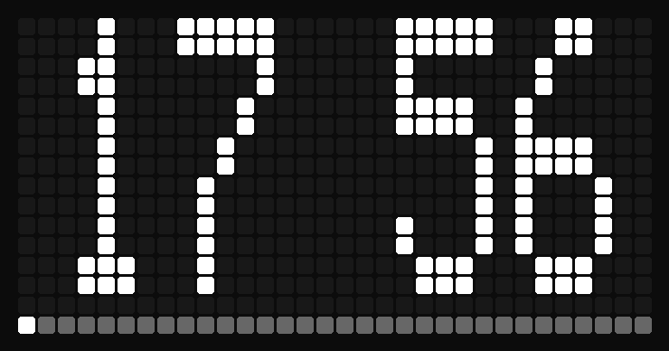
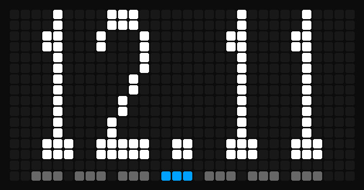
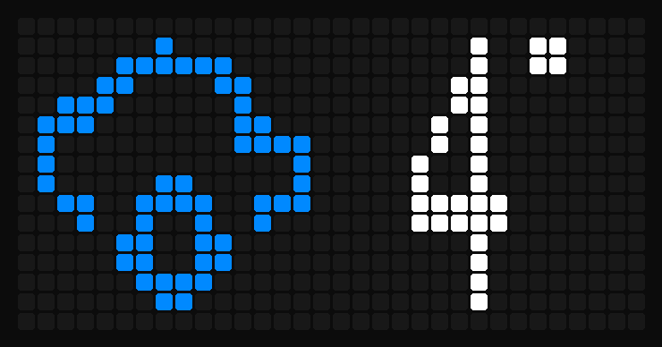
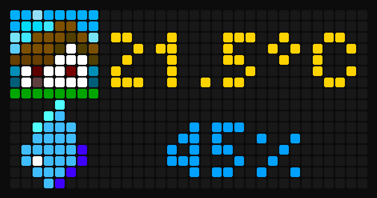
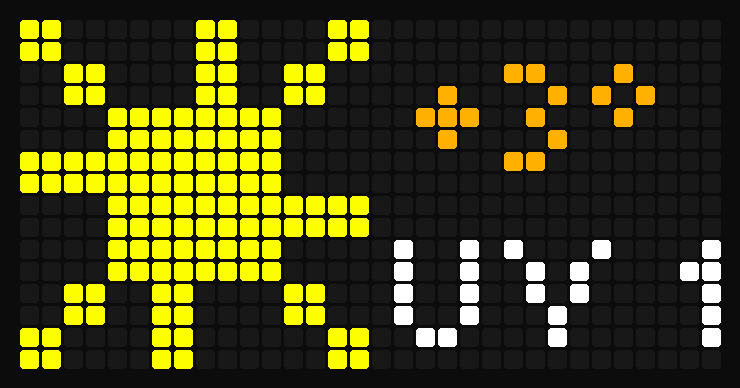
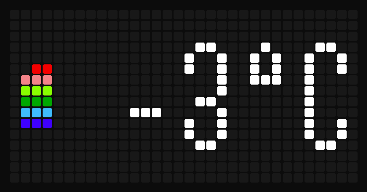
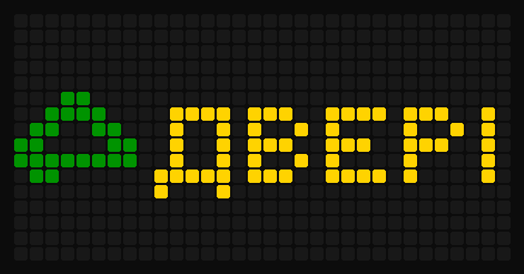
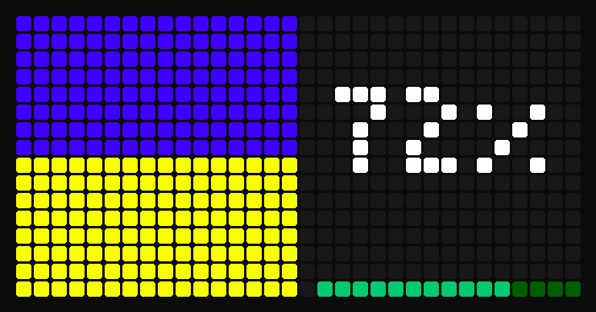
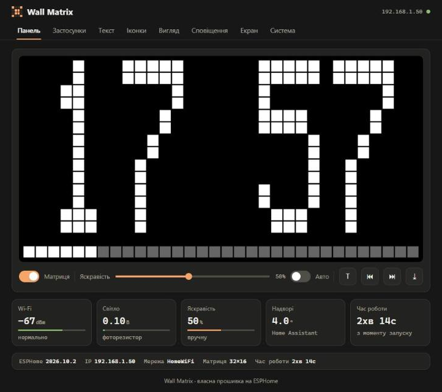

# Wall Matrix

Настінна інформаційна панель у дусі [AWTRIX](https://blueforcer.github.io/awtrix3/) на **ESPHome**:
екран 32×16 із восьми RGB-матриць 8×8, власна веб-панель із живим переглядом, інформери з даними
Home Assistant, сповіщення, іконки й анімації, REST API у стилі AWTRIX NG.

> **Це експеримент — перевірка можливостей штучного інтелекту.** Проєкт від ідеї до робочого
> пристрою створено в діалозі з AI-асистентом (Claude, Anthropic): вибір заліза й схема підключення,
> прошивка ESPHome і власний компонент на C++, веб-панель, REST API, документація та скриншоти.
> Людина ставила задачі, перевіряла результат на залізі й ухвалювала рішення; код писав AI.
> Користуйтеся на власний розсуд — проєкт працює, але не проходив тривалого тестування.

| | | |
|:-:|:-:|:-:|
|  |  |  |
| Годинник | Дата й день тижня | Погода з HA |
|  |  |  |
| Інформер: два рядки, іконки 8×8 | Інформер: іконка 16×16 | Інформер в один рядок |
|  |  |  |
| Сповіщення з іконкою | Сповіщення | Застосунок через API з прогресом |



## Можливості

- **Екран 32×16**: 8 панелей WS2812B 8×8 у сітці 4×2, одна лінія даних, плата YD-ESP32-23 (ESP32-S3 N16R8)
- **Застосунки** в черзі з порядком і тривалістю: годинник, дата, погода, два рядки тексту
- **Інформери** — власні застосунки з веб-панелі: дані сутностей Home Assistant у два рядки чи один
  високий, з одиницями виміру, іконками й пошуком сутностей під час набору
- **Сповіщення** з веб-панелі, Home Assistant чи API — з іконкою чи великим шрифтом, черга, утримання
- **Іконки й GIF**: бібліотека до 32 штук, завантаження картинок, **імпорт із каталогу LaMetric / AWTRIX**
  за номером чи назвою
- **REST API у стилі AWTRIX NG** (`/api/v1/apps`, `/notifications`, `/display`, `/icons`, `/informers`)
- **Веб-панель** у стилі AWTRIX NG: живий екран, налаштування, Wi-Fi, без авторизації (домашня мережа)
- Кирилиця, зокрема українські Ґ Є І Ї; ручна та автоматична яскравість; обмеження струму

## Документація

- **[Посібник користувача](docs/GUIDE.md)** — веб-панель вкладка за вкладкою, інформери, іконки,
  сповіщення, Home Assistant, усунення проблем
- **[REST API](docs/API.md)** — усі маршрути з прикладами, `rest_command` для Home Assistant

## Залізо й підключення

```
БЖ 5V 10A ─┬─────────────► 5V кожної панелі (окремий підвід)
           └─► 5V плати
GND ───────┴─► GND плати ─► GND панелей (спільна земля!)

GPIO48 ─► вбудований WS2812 плати ─ DOUT ─[330 Ом]─► DIN панелі 0
GPIO4  ◄─ дільник: 3.3V ─ фоторезистор ─┬─ 10 кОм ─ GND   (необов'язково, для автояскравості)

Порядок панелей (лінією даних):
  [0]─►[1]─►[2]─►[3]
                   └──┐  (провід DOUT[3] → DIN[4])
  [4]─►[5]─►[6]─►[7] ◄┘
```

- **Перетворювач рівнів не потрібен.** Вбудований WS2812 плати живиться від ~4.7 В і сам відновлює
  сигнал до цього рівня. Стрічка має 513 пікселів і ділиться `partition`:
  «Status LED» — піксель 0 (червоний = немає Wi-Fi), «Matrix» — пікселі 1..512.
- Конденсатор 1000 мкФ між 5V і GND біля входу живлення.
- Не використовуйте GPIO 35–37 (PSRAM), 0/3/45/46 (strapping), 19/20 (USB).
- Не підключайте USB одночасно із зовнішнім БЖ, якщо не впевнені в перемичках плати — прошивайте по OTA.
- `max_power` (0.4) — стеля струму ≈ 12 А на повному білому при 100% яскравості. Для БЖ 10 А це
  безпечно лише тому, що на екрані зазвичай світиться мала частка пікселів.

## Швидкий старт

1. Скопіюйте `secrets.yaml.example` → `secrets.yaml` і впишіть Wi-Fi та ключ API
   (`openssl rand -base64 32`).
2. Підключіть плату до роз'єму **COM** і прошийте:
   ```bash
   esphome run wall-matrix.yaml
   ```
   Якщо порт не визначається: затиснути BOOT → натиснути RST → відпустити BOOT.
   Далі — по Wi-Fi: `esphome run wall-matrix.yaml --device <IP>`.
3. Відкрийте `http://wall-matrix.local/` (або IP панелі) і ввімкніть **Тестовий екран** («Екран»):
   панелі мають іти веселкою (верх: червоний → зелений, низ: блакитний → рожевий), біла точка — у лівому
   верхньому куті кожної, діагональ — рівна. Якщо діагональ рветься всередині панелі —
   `panel_serpentine: "true"` у `wall-matrix.yaml`.
4. Додайте пристрій у Home Assistant (ключ шифрування — `api_key`) і виберіть сутність погоди:
   «Застосунки» → «Погода» → «Сутність».

Без Wi-Fi панель піднімає точку доступу **«Wall Matrix Fallback»** (пароль `12345678`) — під'єднайтеся
до неї, і відкриється веб-панель, де можна вибрати мережу.

## Структура проєкту

```
wall-matrix.yaml          # головний файл: substitutions (піни, налаштування) + пакети
packages/core.yaml        # плата, Wi-Fi, OTA, API та action'и notify / dismiss / set_text
packages/display.yaml     # стрічка, шрифти, іконки погоди, display
packages/sensors.yaml     # час (HA + SNTP), погода, фоторезистор
packages/admin.yaml       # налаштування (template-сутності) + підключення веб-панелі
components/matrix_web/    # веб-сервер, REST API, рушій застосунків і сповіщень, інформери, іконки
web/index.html            # веб-панель (стискається й вшивається в прошивку під час збирання)
includes/matrix_gfx.h     # малювання: цифри, годинник, дата, текст, іконки, гамма
docs/                     # посібник, API, скриншоти
```
