# Посібник користувача Wall Matrix

> Проєкт — експеримент із перевірки можливостей штучного інтелекту: прошивку, веб-панель і цю
> документацію створено AI-асистентом (Claude, Anthropic) за задачами й перевірками людини.

Веб-панель відкривається за адресою `http://wall-matrix.local/` або за IP панелі (його видно на
вкладці «Панель» і в Home Assistant). Авторизації немає. Усі налаштування зберігаються у флеші через
кілька секунд після зміни й переживають перезавантаження; більшість із них видно також у Home Assistant.

Залізо: плата [YD-ESP32-23 (ESP32-S3 N16R8)](https://www.espboards.dev/esp32/yd-esp32-s3/) —
специфікація й розпіновка на espboards.dev; схема підключення — у [README](../README.md#залізо-й-підключення).

**Зміст**

1. [Панель](#1-панель)
2. [Застосунки й черга](#2-застосунки-й-черга)
3. [Інформери](#3-інформери)
4. [Текст](#4-текст)
5. [Іконки](#5-іконки)
6. [Сповіщення](#6-сповіщення)
7. [Вигляд, Екран, Система](#7-вигляд-екран-система)
8. [Home Assistant](#8-home-assistant)
9. [Усунення проблем](#9-усунення-проблем)

---

## 1. Панель

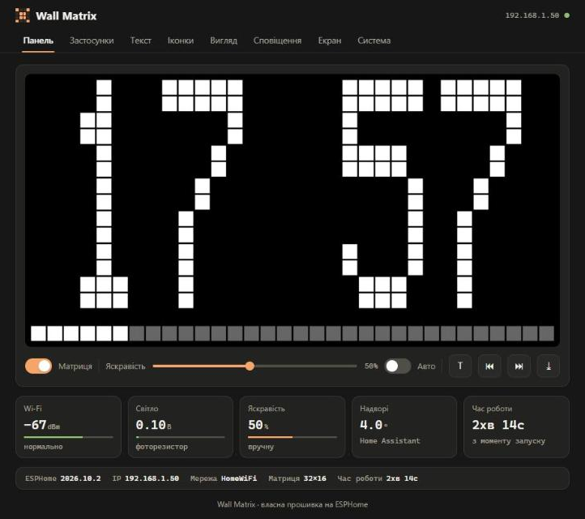

- **Живий екран** — те, що зараз на матриці (≈ 5 кадрів/с). Кнопка ⤓ зберігає знімок у PNG.
- **Матриця** — увімкнути / вимкнути, **Яскравість**, **Авто** — автояскравість за фоторезистором.
- **T** — показати застосунок «Текст»; **⏮ ⏭** — попередній / наступний застосунок.
- Картки: сигнал Wi-Fi, датчик світла, яскравість, температура надворі, час роботи.

## 2. Застосунки й черга

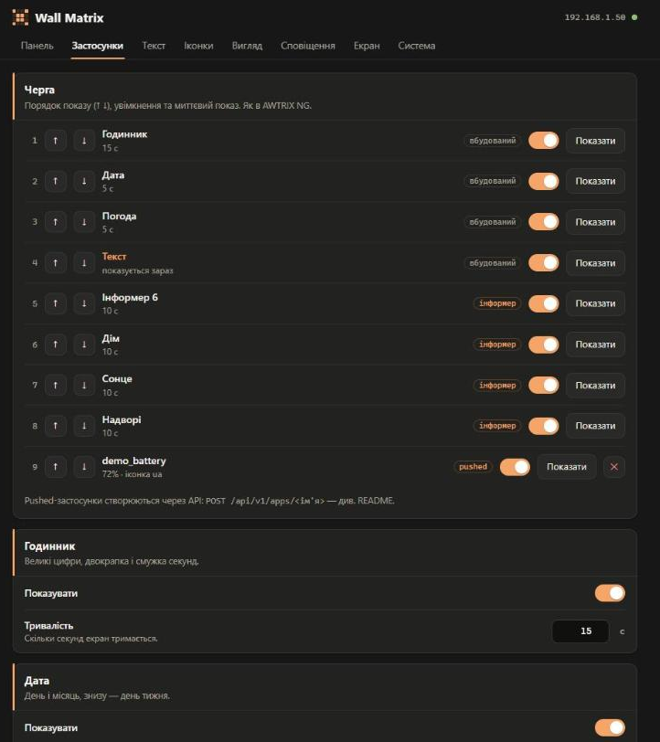

Застосунки показуються по черзі. У блоці **«Черга»**:

- **↑ ↓** — порядок; перемикач — увімкнути / вимкнути; **«Показати»** — показати зараз, після чого
  ротація повернеться туди, де була;
- позначки: **вбудований** (годинник, дата, погода, текст), **інформер** (ваш із веб-панелі),
  **pushed** (надісланий через API, можна видалити ✕).

Застосунок, якому нема чого показати, пропускається: погода — поки немає даних з HA, текст — якщо
обидва рядки порожні. Нижче — налаштування вбудованих застосунків (тривалість, сутність погоди тощо).

**Погода.** У полі «Сутність» виберіть `weather.*` (температура + іконка за станом: сонце, хмари, дощ…)
або `sensor.*` з температурою (лише число). Поле підказує сутності під час набору — див.
[пошук сутностей](#пошук-сутностей).

## 3. Інформери

Інформер — ваш власний застосунок: дані з Home Assistant у **два рядки** або **один високий рядок**.

| Два рядки, іконки 8×8 | Іконка 16×16 на обидва рядки | В один рядок |
|:-:|:-:|:-:|
| 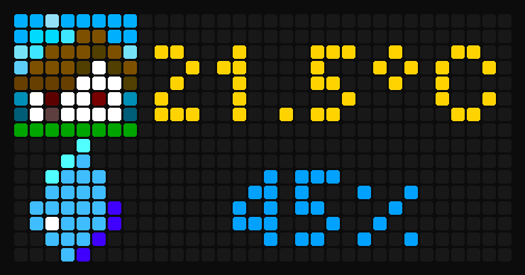 | 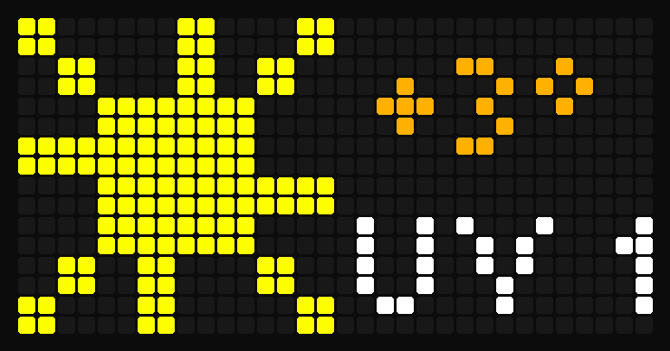 | 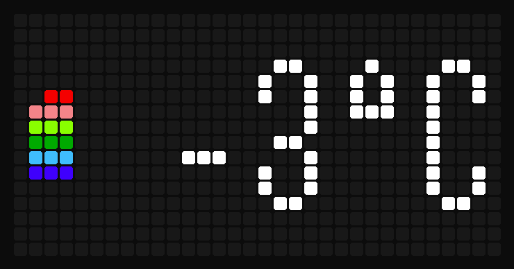 |

«Застосунки» → **«Мої інформери»** → **«＋ Додати інформер»** створює шаблон і відкриває редактор:

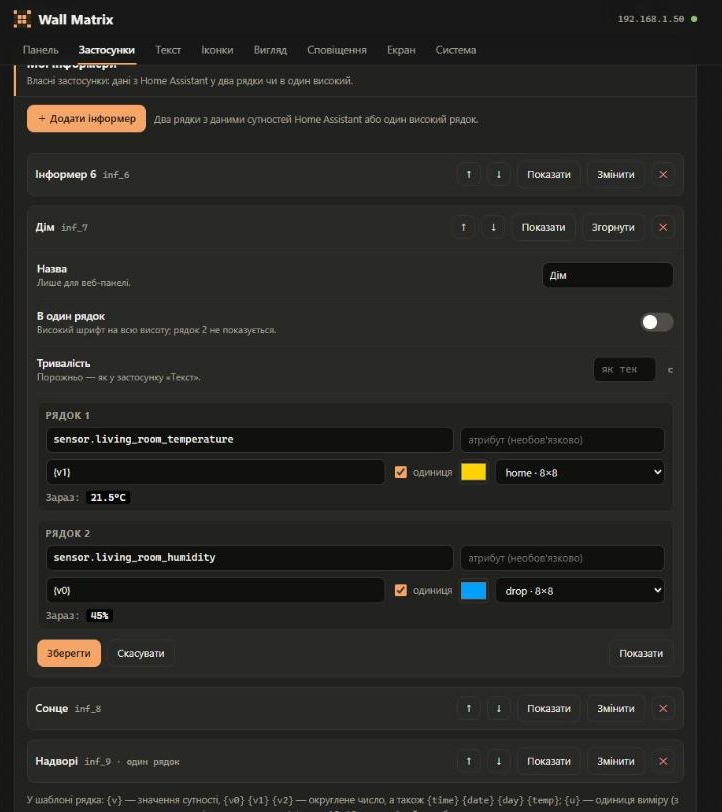

- **Назва** — лише для веб-панелі й черги.
- **В один рядок** — високий шрифт на всю висоту (≈ 6 символів), рядок 2 не показується.
- **Тривалість** — скільки секунд показувати; порожньо — як у застосунку «Текст».
- **Рядок 1 / Рядок 2**:
  - **сутність** — будь-яка сутність HA (пошук під час набору); можна залишити порожньою й написати
    просто текст;
  - **атрибут** — якщо потрібне не стан, а атрибут (наприклад, `temperature` у `weather.*`);
  - **шаблон** — що показувати. Порожній шаблон = `{v}`;
  - **одиниця** — додавати одиницю виміру сенсора одразу після значення;
  - **колір** і **іконка** з бібліотеки.
- **«Зараз: …»** під рядком — текст, який зараз на матриці (оновлюється кожні 3 с).
- **Зберегти**, **Скасувати**, **Показати**, ↑↓ (місце в черзі), ✕ (видалити).

**Шаблон рядка**

| Підстановка | Що дає | Приклад |
|---|---|---|
| `{v}` | значення як є | `21.47` |
| `{v0}` `{v1}` `{v2}` | число з 0 / 1 / 2 знаками | `21`, `21.5`, `21.47` |
| `{u}` | одиниця виміру сенсора | `°C` |
| `{time}` `{date}` `{day}` | час, дата, день тижня | `17:56`, `12.11`, `Чт` |
| `{temp}` | температура з застосунку «Погода» | `4°` |

З галочкою «одиниця» шаблон `{v1}` дає `21.5°C`; `{v0} {u}` — `21 °C`; без галочки `{v1}°` — `21.5°`.
Поки даних немає (HA не підключений, сутність недоступна), замість значення — «—».

**Іконки:** у кожному рядку — 8×8; якщо в рядку 1 іконка **16×16**, вона займає обидва рядки, а текст
стоїть праворуч. Для рядка 2 доступні лише 8×8.

Довгий текст біжить: спершу секунду стоїть, далі йде по колу з проміжком (як в AWTRIX).
Увесь текст за замовчуванням великими літерами — «Вигляд» → «Великі літери».

## 4. Текст

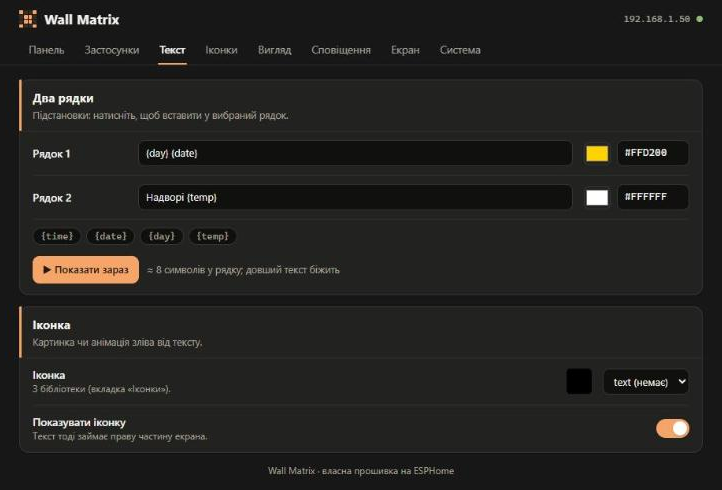

Вбудований застосунок «Текст» — два рядки з підстановками `{time}` `{date}` `{day}` `{temp}` та
іконка з бібліотеки ліворуч. Натисніть підстановку, щоб вставити її в рядок, де стоїть курсор.
Ці ж рядки можна задавати з Home Assistant (див. [Home Assistant](#8-home-assistant)).

## 5. Іконки

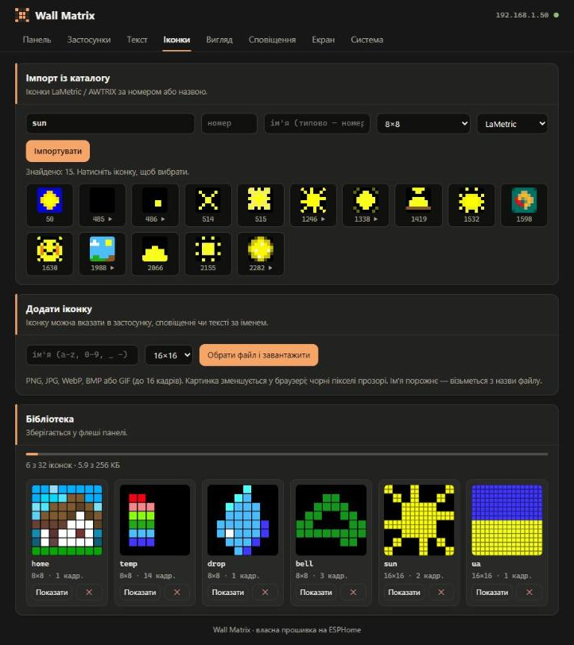

**Імпорт із каталогу.** Введіть назву англійською (`sun`, `home`, `wifi`…) — з'являться іконки з
каталогу LaMetric, ▶ позначає анімовані. Натисніть потрібну (або впишіть номер), за бажанням змініть
ім'я й розмір і натисніть **«Імпортувати»**.

- Це ті самі номери іконок, що в AWTRIX (наприклад, 608, 1221). Типове ім'я іконки — її номер, тож
  посилання на кшталт `"icon": "608"` працюватимуть як в AWTRIX.
- Пошук охоплює ≈ 2000 популярних іконок; будь-яку іншу можна імпортувати за номером — повний каталог
  з номерами: [developer.lametric.com/icons](https://developer.lametric.com/icons).
- Іконки LaMetric мають розмір 8×8; «16×16 (збільшити)» подвоює пікселі без розмиття.
- **AWTRIX Hub** — для іконок з `awtrix.de` потрібен ключ облікового запису Hub; він зберігається
  лише в цьому браузері.

**Своя картинка.** «Додати іконку» → ім'я, розмір 8×8 або 16×16 → файл PNG, JPG, WebP, BMP чи GIF.
Картинка зменшується в браузері; GIF — до 16 кадрів із власними затримками. Чорні пікселі прозорі.

**Бібліотека** — до 32 іконок (256 КБ): анімований перегляд, «Показати» (сповіщення з іконкою), ✕.

## 6. Сповіщення

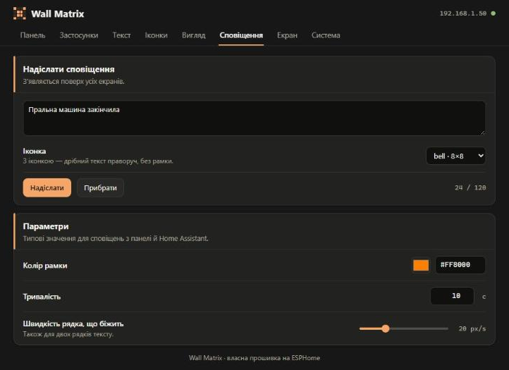

| З іконкою | Без іконки |
|:-:|:-:|
| 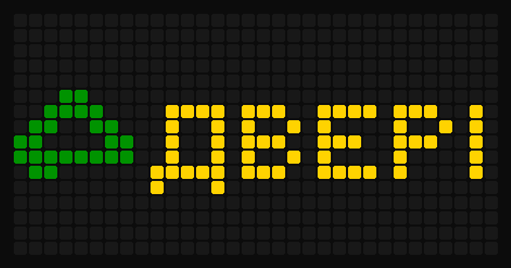 | 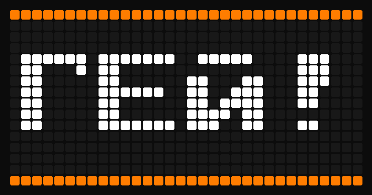 |

Сповіщення з'являється поверх застосунків. **З іконкою** — дрібний текст праворуч від неї; **без
іконки** — великий шрифт і кольорова рамка. «Параметри» задають типовий колір рамки, тривалість і
швидкість рядка, що біжить (вона ж — для текстів і інформерів).

## 7. Вигляд, Екран, Система

- **Вигляд** — 24/12 год, блимання двокрапки, смужка секунд, кольори годинника й дати, початок тижня,
  великі літери.
- **Екран** — яскравість, автояскравість і її мінімум, датчик світла, **тестовий екран** для
  перевірки порядку панелей і **підключення матриці**:
  - *після вбудованого світлодіода* — DIN матриці до DOUT світлодіода плати (рівень сигналу піднімає він);
  - *напряму на пін* — DIN матриці до вибраного GPIO (бажано через перетворювач рівнів 74AHCT125);
  - *змійка всередині панелі* — для панелей 8×8, де непарні рядки йдуть справа наліво;
  - *розмір матриці* — ширина від 2 до 8 модулів (16…64 px), висота — 2 модулі; типово 32×16 (4 × 2);
  - *порядок модулів* — по рядах (у кінці ряду провід до початку наступного) або змійкою (другий ряд
    справа наліво, модулі в ньому перевернуті на 180°).

  «Зберегти й перезавантажити» — зміни діють після перезавантаження; рядок «Зараз: …» показує
  активне й збережене підключення.
- **Система**:
  - **Wi-Fi** — поточна мережа, знайдені мережі (натисніть, щоб підставити), підключення до іншої;
  - **Home Assistant** — адреса й токен для пошуку сутностей;
  - перезавантаження й безпечний режим.

### Пошук сутностей

Поля сутностей (погода, інформери) підказують варіанти під час набору: назва, ID, поточний стан.
Для цього в «Система» → «Home Assistant» вкажіть адресу HA (`http://homeassistant.local:8123`) і
**довготривалий токен доступу** (профіль HA → Безпека → «Довготривалі токени доступу») і натисніть
«Перевірити». Браузер звертається до HA напряму; токен зберігається лише в цьому браузері й на панель
не передається. Без токена поля працюють як звичайні — ID сутності можна ввести вручну.

## 8. Home Assistant

Додайте панель: Налаштування → Пристрої та служби → ESPHome (ключ шифрування — `api_key` із
`secrets.yaml`). Після цього панель сама отримує стани потрібних сутностей.

**Дії ESPHome**

```yaml
# Сповіщення (duration: 0 і порожній color — значення з веб-панелі)
action: esphome.wall_matrix_notify
data:
  message: "Пральна машина закінчила"
  duration: 15
  color: "#00A0FF"
```

```yaml
# Рядки застосунку «Текст»; show: true — одразу показати
action: esphome.wall_matrix_set_text
data:
  line1: "Вдома {temp}"
  line2: "CO2 640"
  show: true
```

Прибрати сповіщення — `esphome.wall_matrix_dismiss`.

**Через REST API** (сповіщення з іконкою, pushed-застосунки з прогресом) — див. [API](API.md) і
приклад `rest_command` там.

## 9. Усунення проблем

| Проблема | Що зробити |
|---|---|
| Панель не відкривається | Перевірте IP у роутері; спробуйте `http://<IP>/` замість `.local`. Якщо панель не в мережі — шукайте точку доступу «Wall Matrix Fallback». |
| Погода не показується | Панель додана в HA? Сутність погоди правильна («Застосунки» → «Погода»)? Застосунок пропускається, поки немає даних. |
| В інформері «—» | Сутність недоступна або HA не підключений. Перевірте ID; «Зараз: …» покаже результат. |
| Пошук сутностей не працює | «Система» → «Home Assistant» → «Перевірити»: адреса з `http://` і портом, дійсний токен. |
| Діагональ на тестовому екрані «сходинками» | `panel_serpentine: "true"` у `wall-matrix.yaml` і перепрошити. |
| Імпорт іконки «немає такої» | Перевірте номер у [каталозі LaMetric](https://developer.lametric.com/icons); для AWTRIX Hub потрібен ключ. |
| Анімація з 1 кадру | Файл має бути GIF; у PNG/JPG лише один кадр. |
